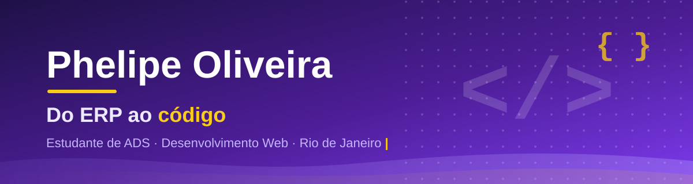
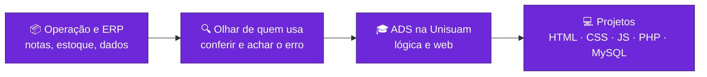

 

 

<table align="center">
  <tr>
    <td align="center" width="33%"><b>🎓 Formação</b> ADS · Unisuam conclusão prevista: 2028</td>
    <td align="center" width="33%"><b>💼 Experiência</b> 2+ anos com ERP e rotinas administrativas Auxiliar Administrativo (CLT)</td>
    <td align="center" width="33%"><b>🎯 Procuro</b> Estágio em desenvolvimento, análise ou suporte a sistemas Rio de Janeiro · inglês avançado</td>
  </tr>
</table>

> **English:** ADS student in Rio de Janeiro, Brazil. 2+ years of hands-on experience with ERP and back-office processes, now building web development skills through real projects.

---

## 🧭 Da operação ao código

Antes de escrever código, passei dois anos do outro lado: usando, conferindo e treinando outras pessoas em sistemas corporativos. Agora uso essa experiência para construir.

---

## 🧠 O que o ERP me ensinou sobre código

- **Dado errado custa caro.** Conferir divergências entre estoque e sistema me ensinou a desconfiar de toda entrada de dados. Por isso meus formulários validam login, senha e telefone no formato brasileiro.
- **Quem usa não lê manual.** O Wish a Drink dá feedback por toasts e modais, sem `alert()` nativo, e tem uma barra de acessibilidade com ajuste de fonte e alto contraste.
- **Processo bom é o que outra pessoa consegue seguir.** Já treinei estagiários na empresa e documento meus projetos para que qualquer pessoa entenda e rode.

---

## 📌 Projetos

<table>
  <tr>
    <td width="50%" valign="top">
      <h3>🍹 Wish a Drink</h3>
      
E-commerce de bebidas, projeto em grupo da faculdade.

      <ul>
        <li>11 páginas, modo escuro e barra de acessibilidade</li>
        <li>Login com 2FA, troca de senha e painel administrativo</li>
        <li>Senhas com hash, PDO prepared statements e proteção contra CSRF</li>
      </ul>
      
      
      
      
      
        
      <a href="https://github.com/LipeOliv-Dev/wish-a-drink"><b>Ver repositório →</b></a>
    </td>
    <td width="50%" valign="top">
      <h3>♻️ EcoTech</h3>
      
Plataforma de reciclagem com gamificação, projeto acadêmico de front-end.

      <ul>
        <li>Pontos, recompensas, mapa de coleta e scanner de produtos</li>
        <li>Documentação técnica e apresentação do projeto</li>
        <li>Política de privacidade conforme a LGPD</li>
      </ul>
      
      
      
        
      <a href="https://github.com/LipeOliv-Dev/ecotech"><b>Ver repositório →</b></a>
    </td>
  </tr>
</table>

---

## 🛠️ Tecnologias

*Nível acadêmico, em evolução constante.*

**Front-end**

**Back-end e banco de dados**

**Sistemas e produtividade**

---

## 🚀 Atualmente

- Desenvolvendo o back-end em PHP e MySQL do Wish a Drink
- Aprofundando lógica de programação em Python e JavaScript
- Aprendendo a organizar e documentar projetos no GitHub

---

## 🤝 Vamos conectar?

Se quiser trocar uma ideia sobre desenvolvimento, sistemas ou oportunidades de estágio:

 

*Cada projeto é um passo. Obrigado pela visita!* 🚀

